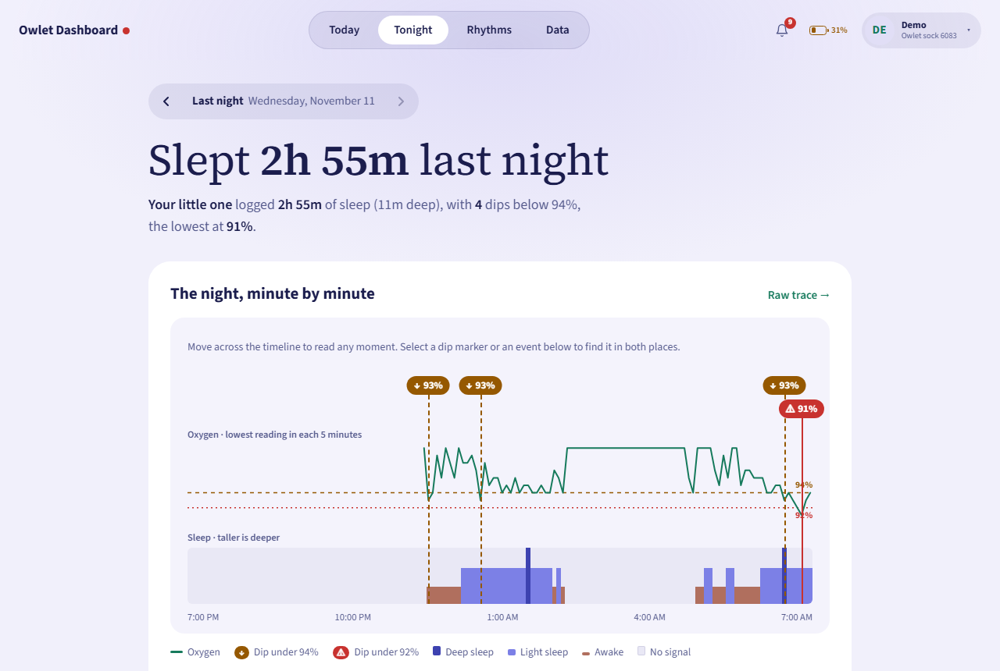
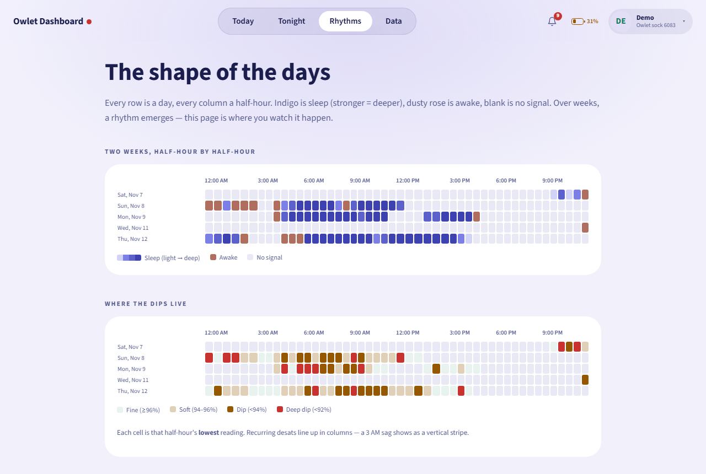
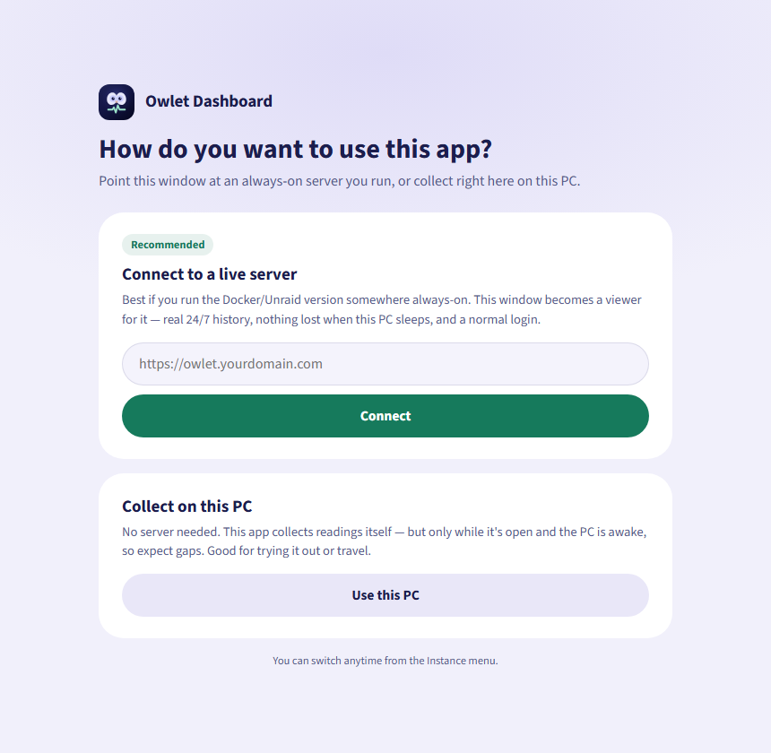

# Owlet Dashboard

The missing Owlet desktop app — an **unofficial**, open-source, provided-as-is history
collector and dashboard for Owlet Dream Sock / Smart Sock data. Not affiliated with or
endorsed by Owlet Baby Care.

Owlet Dashboard stores local historical vitals from the unofficial Owlet cloud API and shows oxygen, heart-rate, movement, and sleep/wake trends in a private web dashboard. It is designed for parents who want retrospective history beyond the short recent window shown in the Owlet app. The Windows desktop app also adds an **extra** low-oxygen alert on the PC (a small always-on-top widget, a screen flash and an alarm sound), meant to be heard and seen while you game or work. It supplements the Owlet base station; it never replaces it.

The Owlet app only exposes a short recent window. This server polls Owlet's unofficial cloud API via [`pyowletapi`](https://pypi.org/project/pyowletapi/), stores readings locally, and serves a simple historical dashboard.

> ## Not a medical alarm
>
> Owlet Dashboard is **not a medical device and not a medical alarm**. It must never be
> your only way of knowing your baby is in trouble.
>
> - It depends on **Owlet's cloud, your internet connection and this PC** (or your
>   server). If any of them fails, alerts stop, and the app may not be able to tell you.
> - **The Owlet base station stays the primary alarm.** Keep it plugged in, in the
>   room, and turned up. Nothing here replaces it or the Owlet app.
> - The green "armed" indicator in the desktop app means one thing only: **this PC's
>   alert path is working** (the server answers, data is fresh, sound can play, the PC
>   is staying awake). It says nothing about your baby, and it can't see failures on
>   Owlet's side or in your network.
> - The history, charts and reports are for looking back at trends, not for making
>   medical decisions. Talk to your paediatrician about readings you are worried about.

## Screenshots

**Today** — live vitals with personal baselines, touch/drag/zoom charts, sleep at a glance,
and one-tap supplemental-O₂ logging:


| **Tonight** — the narrative night report | **Rhythms** — the pattern reader |
| --- | --- |
|  |  |

## Try it in two minutes — the Windows app

The fastest way in: **[download the desktop app from the releases
page](https://github.com/pbozzay/owlet-dashboard/releases/latest)**, run the installer.
On first launch it asks how you want to use it — no account, nothing to configure:



There are three ways to run Owlet Dashboard, and the app can be any of them:

- **Standalone app — _Collect on this PC._** The app polls Owlet and stores everything
  locally (`%LOCALAPPDATA%\owlet-dashboard`), no server needed. The catch: it only
  records **while the app is open and the PC is awake**, so a closed laptop or sleeping
  PC leaves permanent gaps (Owlet's API can't backfill) — the charts show them honestly.
  Great for trying it out or for travel.
- **Always-on server — the [Docker/Unraid deployment](#run-with-docker-recommended).** Runs 24/7
  and never sleeps, so you get gapless history. Reach it from any browser.
- **Connected viewer app — _Connect to a live server._** Point the desktop app at your
  always-on server's URL and it becomes a pure **viewer**: full 24/7 history, nothing
  lost when your PC sleeps, and **native Windows toast alerts** on your machine — without
  running a second collector. This is the best of both worlds if you already run the
  server.

Only run one collector per Owlet login: two collectors refresh the same Owlet token and
sign each other out. So if you have the server, use **Connect to a live server** rather
than _Collect on this PC_. You can switch modes anytime from the window's **Instance** menu.

The desktop app is also where the PC alerts live. Before relying on them, open
**Settings → This PC** and press **Test amber** and **Test red**: you should see the flash
and hear the alarm. Then read [`desktop/README.md`](desktop/README.md), which explains
every alert setting and what the armed indicator means.

Prefer to compile it yourself? Build steps live in
[`desktop/README.md`](desktop/README.md) (PyInstaller sidecar + Tauri shell).

## What's new in 0.2 (Windows desktop app)

Version 0.2 is about trusting the extra alert on your PC, and a new look. Full details
and every setting are in [`desktop/README.md`](desktop/README.md).

- **Alert settings** (Settings → Alerts, works in the desktop app and the hosted
  dashboard): how long Snooze lasts (5–120 s, default 15), how old the newest reading
  may be before the app warns that data has stopped (30–300 s, default 60), and an
  optional gentle **awake chime** (off by default) when your baby changes from asleep
  to awake.
- **Settings → This PC** (desktop app only): which monitor flashes, the alarm sound and
  speaker, an option that unmutes this PC and raises the volume on a red alert (on by
  default, restored afterwards), keep the PC awake while collecting, start with Windows,
  a game mode, hiding the widget from screen sharing, test buttons and a first-run
  "test your alerts" step.
- **"I'm checking"**: a longer silence than Snooze, for when you are already on your
  way. Escalation from amber to red still breaks through.
- **Hotkeys and controller snooze**: snooze, "I'm checking", show/hide widget and
  click-through from the keyboard, and snooze from a game controller (Xbox, and
  PlayStation DualShock 4 / DualSense) while a game has focus. Both are off until you
  set them.
- **A better widget**: three sizes, adjustable opacity, click-through, edge snapping, an
  armed dot, and a live tray icon that shows the current SpO₂ in the alert-tier colour.
- **Armed indicator** on the widget, the tray tooltip and the dashboard, with a plain
  sentence when something is wrong ("Windows is muted", "PC may sleep", "No data for
  3m"). Remember what it does and does not mean (see the box at the top).
- **A new night-sky look** across the dashboard, widget and alert overlay, with bundled
  fonts so it works offline. Dark is the default and light is kept.

## What it stores

Each poll stores:

- timestamp
- device serial
- heart rate
- oxygen saturation / SpO₂
- movement
- sleep state, when available
- battery
- skin temperature, when available
- raw normalized payload for future fields

## Run with Docker (recommended)

```bash
docker run -d --name owlet-dashboard \
  -p 8888:8888 \
  -v /path/to/appdata/owlet-dashboard:/data \
  ghcr.io/pbozzay/owlet-dashboard:latest
```

Images are published to the GitHub Container Registry
(`ghcr.io/pbozzay/owlet-dashboard:latest`, rebuilt on every push to main; each build is
also tagged with its commit SHA if you want to pin one).

The container stores everything in `/data` (SQLite database + WAL). It starts as
root only long enough to make that volume writable for the runtime user, then drops
privileges. By default it runs as uid/gid `1000:1000`; set `PUID`/`PGID` to match
your host share's owner if you prefer (on **Unraid**, the appdata share is usually
`nobody:users` = `99:100`):

```bash
docker run -d --name owlet-dashboard \
  -e PUID=99 -e PGID=100 \
  -p 8888:8888 \
  -v /mnt/user/appdata/owlet-dashboard:/data \
  ghcr.io/pbozzay/owlet-dashboard:latest
```

Put your reverse proxy (nginx, Nginx Proxy Manager, ...) in front of port 8888 with
HTTPS; the app trusts `X-Forwarded-*` headers. On Unraid: add a container using the
GHCR image, map `/data` to an appdata share, map the port, and (optionally) add
`PUID=99` / `PGID=100` variables so the database files are owned by `nobody:users`.
The container fixes `/data` ownership on startup, so a fresh install initializes its
own database with no manual `chown` needed.

Open the site, create an account (the first signup adopts any data from a
pre-multi-user database), and link your Owlet login on the onboarding page. Owlet
passwords are verified once with Owlet and never stored — only access tokens.
Region options: `world` (typical US/global account) or `europe` (EU account).

## Local development

```bash
python -m venv .venv
.venv/Scripts/python -m pip install -e ".[dev]"   # .venv/bin/... on mac/linux
.venv/Scripts/python -m uvicorn app.main:app --host 127.0.0.1 --port 8888
```

Open:

- Sign in / sign up: <http://127.0.0.1:8888/>
- Health: <http://127.0.0.1:8888/api/health>
- All readings JSON (session required): <http://127.0.0.1:8888/api/readings>
- Recent readings JSON: <http://127.0.0.1:8888/api/readings?hours=24>
- Summary JSON: <http://127.0.0.1:8888/api/summary>

Dashboard features:

- installable PWA shell with manifest, icons, service worker, and an in-app install button
- live auto-refresh every 15 seconds with the countdown folded into the Refresh button
- first-load overlay that shows progress while readings load and charts draw, so the dashboard does not feel frozen during startup
- primary full-width vitals trace with synchronized drag/pan/zoom, plus a dotted red 85% SpO₂ reference line for spotting deeper drops
- top-bar device selector with `device=<serial>` URL filtering, compact mobile sock labels, and a one-row mobile control strip with live pulse, notification badge, O₂ challenge shortcut, battery, and refresh icon
- range, smoothing, overlay toggles, and export inside a single grouped main graph toolbar; raw points are the default, and smoothed lines keep offline/no-signal points at zero without letting them contribute to averages
- mobile defaults to a 6-hour range and uses direct horizontal touch-drag panning on time-series charts; desktop drag-select still zooms
- compact `O₂+` menu in the main graph header for creating oxygen challenges from the current graph window or manually entered times
- at-a-glance sleep card shows the current sleep/wake state with duration, while retaining 24h light/deep/awake totals underneath
- oxygen challenge tracking for marked off-oxygen windows, shown as blue chart bands and excluded from normal averages/stats
- mobile-safe oxygen challenge modal with an explicit Add new O₂ challenge form, editable start/end times, notes, delete action, per-challenge duration, avg/min O₂, avg HR, low/critical O₂ samples, sleep/awake time, and same-length prior-window comparison
- compact sleep/wake accessory strip directly under the main vitals trace with aligned time labels, time-based hover mapping, and hover-highlighted sleep-phase bands on the main chart
- optional full-height sleep/wake highlights on the main chart, with exact state windows or a "guess sleep windows" mode
- ballpark sleep/wake highlights exclude exact disconnected/no-signal spans and treat meaningful movement bursts as awake evidence
- compact O₂ trend companion chart inside the main vitals card, calculated after the primary dashboard renders, using a MACD-style 30m average vs 4h baseline signal with darker, thicker red/green bars and visible gaps across offline/missing-data periods
- synchronized horizontal time scrollbar for panning the visible window across all aligned charts, with extra history loaded behind the default range, lazy older-history loading near the left edge, and refreshes that preserve the current zoom/pan window unless the scrollbar is already at the latest edge
- grey disconnected/offline bands when Owlet reports zero-valued vitals or explicit sock disconnected/off flags, including stale nonzero vitals held during disconnects
- offline/no-signal readings are zeroed in the dashboard trace/table, kept in raw payloads for debugging, and excluded from averages, trends, and sleep analysis
- Owlet alert/notification capture for low oxygen, sock disconnect/off, heart-rate, battery, and base-power alerts emitted by Owlet/API data; measured SpO₂ dips are shown in stats/challenges/graphs but do not create notification-pane alerts
- BTC/ETH/XMR price glance powered by CoinGecko, plus an optional hidden-by-default BTC price overlay on the main vitals chart
- "today at a glance" latest vitals card plus top-bar battery indicator with percent and remaining-time tooltip when available
- breathing trend card comparing recent vs prior oxygen averages
- sleep/awake estimate using Owlet sleep-state codes (`1=awake`, `8=light sleep`, `15=deep sleep`)
- 5m/15m/30m/1h/6h/12h/daily drill-down averages for oxygen, HR, sleep, and awake time
- compact mobile layout with true fixed modals for notifications and oxygen challenges
- click a row to inspect that normalized reading
- CSV download for the current filtered view

Analytics endpoints:

- Insights: <http://127.0.0.1:8888/api/insights?hours=24>
- Hourly rollups: <http://127.0.0.1:8888/api/rollups?bucket=hour&hours=24>
- Daily rollups: <http://127.0.0.1:8888/api/rollups?bucket=day&hours=168>
- Notifications: <http://127.0.0.1:8888/api/notifications?hours=24>
- Oxygen challenges: <http://127.0.0.1:8888/api/oxygen-challenges?hours=24>
- Compact widget JSON: <http://127.0.0.1:8888/api/widget?hours=24>

The same compact widget payload is available on the tokenized share path at `/share/<token>/api/widget?hours=24`. iOS PWAs cannot create native Home Screen or Lock Screen widgets, but apps like Widgy or Scriptable can poll this JSON URL for a private glanceable widget.

## Internet access

Any HTTPS reverse proxy works; every page requires sign-in, so exposure is gated by
the app's own auth. Deployment notes live in [`docs/deployment.md`](docs/deployment.md).

## Run tests

```bash
.venv/Scripts/python -m pytest -q   # .venv/bin/... on mac/linux
```

## Built with

Credit to the open-source libraries this project stands on:

- [FastAPI](https://fastapi.tiangolo.com/) + [Uvicorn](https://www.uvicorn.org/) — web framework and ASGI server
- [pyowletapi](https://pypi.org/project/pyowletapi/) — unofficial Owlet cloud client
- [aiosqlite](https://github.com/omnilib/aiosqlite) — async SQLite storage
- [Pydantic](https://docs.pydantic.dev/) + [pydantic-settings](https://docs.pydantic.dev/latest/concepts/pydantic_settings/) — models and configuration
- [Chart.js](https://www.chartjs.org/) + [chartjs-plugin-zoom](https://www.chartjs.org/chartjs-plugin-zoom/latest/) + [Hammer.js](https://hammerjs.github.io/) — charts with drag/pan/zoom
- [argon2-cffi](https://argon2-cffi.readthedocs.io/) — password hashing
- [pytest](https://docs.pytest.org/) + [HTTPX](https://www.python-httpx.org/) + [Ruff](https://docs.astral.sh/ruff/) — tests and linting

## Notes on Owlet API fragility

Owlet has no documented public API for this. This project intentionally isolates the unofficial dependency in `app/owlet_client.py`, so if Owlet changes auth/endpoints, the storage/API/dashboard should remain intact and only the adapter should need updates.

Libraries I checked while scaffolding:

- `pyowletapi` — current PyPI package, used here.
- `jlamendo/ha-sensor.owlet` — Home Assistant integration using the modern API.
- `hmostafa17/owlet-dream-logger` — real-time logger/dashboard with more aggressive reconnect logic.
- `edfincham/owlet-sock-scraper` — Go + Postgres + Grafana approach.

## Next improvements

- Web Push for low-O₂ alerts on phones (works on iOS 16.4+ when the app is
  added to the Home Screen as a PWA): a service-worker push handler, push
  subscriptions stored per device, and the server sending a signed push
  (VAPID) when the poller writes a low-O₂ alert. Very buildable on top of
  what exists — the alert already creates a server-side notification row, so
  it's "send a push at that moment" plus a subscribe button.
- Retention/downsampling job so cold rollup computes stay fast as readings grow.
- Add daily sleep rollups in a `sessions` table.
- Add CSV export endpoint.
- Add Grafana/Prometheus option if you want more powerful charts.
