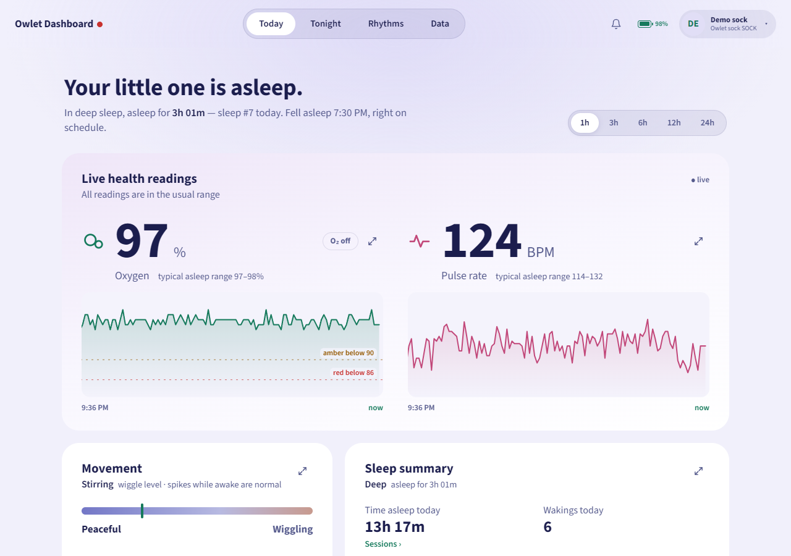

# Owlet Dashboard

An **unofficial**, open-source, provided-as-is history collector and dashboard for Owlet
Dream Sock / Smart Sock data. Not affiliated with or endorsed by Owlet Baby Care.

It polls Owlet's unofficial cloud API via [`pyowletapi`](https://pypi.org/project/pyowletapi/),
stores readings locally (SpO₂, heart rate, movement, sleep state, battery, skin temperature),
and serves a private dashboard with trends beyond the short window the Owlet app shows.
The Windows desktop app adds an **extra** low-oxygen alert on the PC (widget, screen flash,
alarm sound).

> ## Not a medical alarm
>
> This is **not a medical device**. Never rely on it as your only way of knowing your baby
> is in trouble.
>
> - It depends on Owlet's cloud, your internet and this PC/server. If any fail, alerts stop.
> - **The Owlet base station stays the primary alarm.** Keep it plugged in and turned up.
> - The green "armed" indicator only means this PC's alert path is working. It says nothing
>   about your baby.
> - Charts and reports are for looking back at trends, not for medical decisions.



## Windows desktop app

[Download the installer](https://github.com/pbozzay/owlet-dashboard/releases/latest). On
first launch, choose a mode:

- **Collect on this PC** — standalone; records only while the app is open and the PC is
  awake, so sleep leaves permanent gaps.
- **Connect to a live server** — viewer for your always-on server, with native toast alerts.
  Best if you already run the server.

Run only one collector per Owlet login, or the collectors sign each other out. Before relying
on PC alerts, press **Test amber** / **Test red** in **Settings → This PC**. See
[`desktop/README.md`](desktop/README.md) for alert settings and build steps.

## Run with Docker (recommended)

```bash
docker run -d --name owlet-dashboard \
  -p 8888:8888 \
  -v /path/to/appdata/owlet-dashboard:/data \
  ghcr.io/pbozzay/owlet-dashboard:latest
```

Data (SQLite) lives in `/data`. The container runs as `1000:1000` by default; set `PUID`/`PGID`
to match your host share (Unraid: `99`/`100`). Put an HTTPS reverse proxy in front of port
8888 (see [`docs/deployment.md`](docs/deployment.md)).

Open the site, create an account, and link your Owlet login (region `world` or `europe`).
Owlet passwords are verified once and never stored.

## Development

```bash
python -m venv .venv
.venv/Scripts/python -m pip install -e ".[dev]"   # .venv/bin/... on mac/linux
.venv/Scripts/python -m uvicorn app.main:app --host 127.0.0.1 --port 8888
.venv/Scripts/python -m pytest -q
```

The unofficial Owlet dependency is isolated in `app/owlet_client.py`; if Owlet changes its
API, only that adapter should need updates.

## Built with

[FastAPI](https://fastapi.tiangolo.com/), [pyowletapi](https://pypi.org/project/pyowletapi/),
[aiosqlite](https://github.com/omnilib/aiosqlite), [Pydantic](https://docs.pydantic.dev/),
[Chart.js](https://www.chartjs.org/), [argon2-cffi](https://argon2-cffi.readthedocs.io/).
